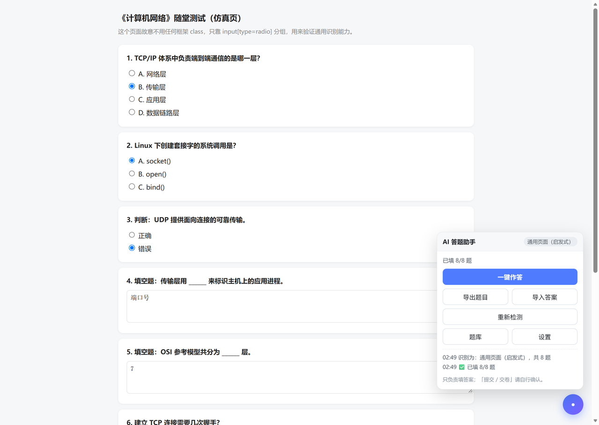
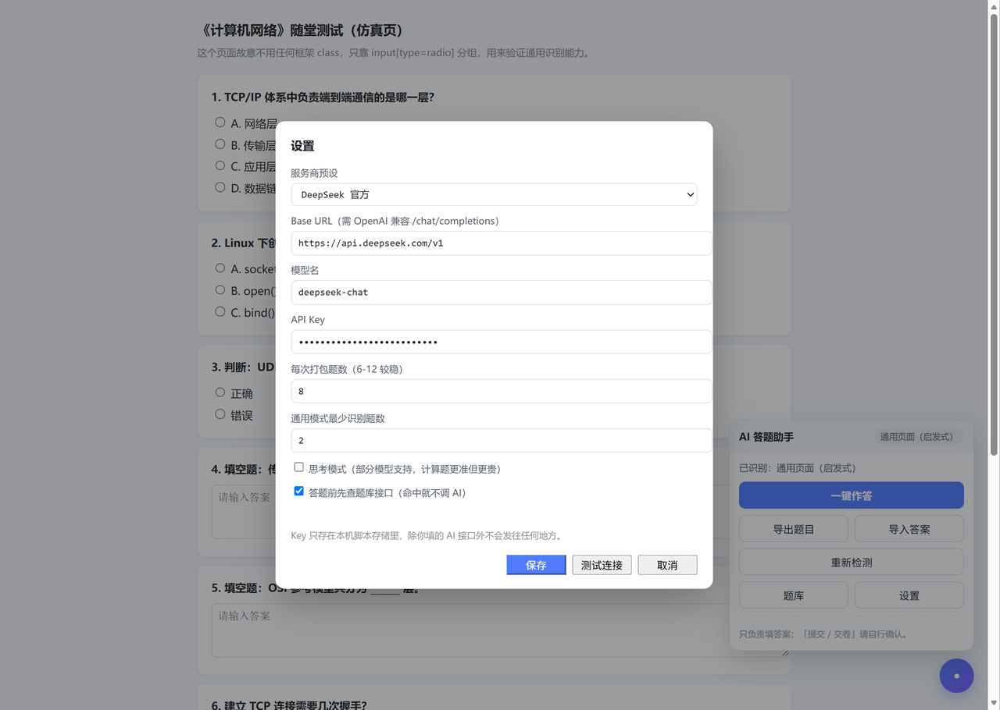
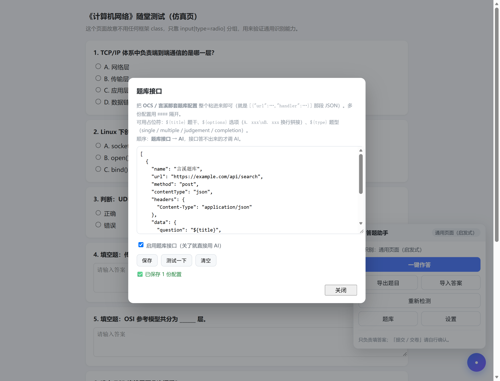

# 头歌学习通AI 答题助手

把网页上的题目抓下来，交给任意 OpenAI 兼容的大模型作答，再自动填回页面。

**头歌（Educoder）/ 超星 / 任意页面通用** · 平台差异由 adapter 层处理 · **没有 API Key 也能用**



> 图为本地仿真页的运行效果：右侧面板显示「已填 8/8 题」，选项与填空均已写入页面。

### ⚠️ 使用提醒

**仅供个人复习、自测与前端自动化学习。**

请遵守所在平台的用户协议，成绩与后果自负。

---


觉得有用的话留下一个 Star⭐️ 吧！
## ✨ 能做什么

- **一键作答** —— 抓题 → **先查题库接口** → 接口没答案的再请求 AI → 自动勾选 / 填写
- **题库接口** —— 直接粘 OCS / 言溪那套题库配置，命中就不调 AI，可配多份
- **导出题目** —— 整份卷子进剪贴板，可直接粘给任意对话式 AI
- **导入答案** —— 支持 `1: B` 逐行格式，也支持 JSON，自动回填
- **重新检测** —— 页面结构变了、识别错了，点一下重新扫描
- **测试连接** —— 填完地址和 Key 先验证，不用开卷子试错
- **多平台** —— 通过 adapter 适配，不写死某一个网站
- **零后端** —— 纯前端，Key 只存在浏览器本地

## 🚀 三步上手

1. **装脚本** —— 把 `ai-answer-helper.user.js` 粘进脚本猫，保存
2. **填 Key** —— 打开任意网页 → 点右下角圆点 → **设置** → 填好三项 → 点 **测试连接**
3. **做题** —— 打开作业页 → 点 **一键作答** → 核对 → **自己点提交**

**脚本只负责填，不负责交卷。** 这是刻意设计：署名和成绩归属由你决定。

> 有题库接口的话先粘进 **题库** 按钮里（OCS 配置直接复制），接口能答的题就不会再花 AI 的钱；题库够全时，连 API Key 都不用填。

## 📦 安装

### 方式一：一键安装（推荐）

先装脚本管理器：[ScriptCat 脚本猫](https://scriptcat.org/) 或 [Tampermonkey](https://www.tampermonkey.net/)。

**推荐从脚本猫商店装**，国内访问稳定，有新版会自动提示：

**https://scriptcat.org/zh-CN/script-show-page/9005**

也可以用下面的 CDN 地址（脚本管理器会自动接管并弹出安装页）：

**https://gcore.jsdelivr.net/gh/wuzhihuijin/touge-answer-helper@main/ai-answer-helper.user.js**

CDN 有缓存，新版本可能延迟几小时才同步。要拿最新版就用上面的脚本猫商店地址。

**别用 `raw.githubusercontent.com` 的链接。** 这个域名在国内经常握手失败，我实测本机连不上（TLS 握手直接断开）。

jsDelivr 的节点在国内时好时坏，主地址打不开就换这两个（实测都能正常下载）：

- `https://testingcf.jsdelivr.net/gh/wuzhihuijin/touge-answer-helper@main/ai-answer-helper.user.js`
- `https://fastly.jsdelivr.net/gh/wuzhihuijin/touge-answer-helper@main/ai-answer-helper.user.js`

装好后打开任意网页，右下角会出现一个圆形按钮。

脚本的 `@updateURL` 指向脚本猫，有新版时脚本管理器会提示更新，不用手动重装。

### 方式二：手动粘贴

1. 打开扩展的「管理面板」→「新建脚本」
2. 删掉模板内容，把 `ai-answer-helper.user.js` 全文粘进去 → **Ctrl+S 保存**

### 方式三：拖文件

把 `.user.js` 文件拖进浏览器窗口，扩展会弹出安装页，点「安装」。

### 注意

**两个脚本别同时装。** 如果之前装过旧版，先禁用或删除，否则会出现两个悬浮球。

## ⚙️ 配置 AI

点右下角圆点展开面板 → **设置**。



### 八个字段

- **服务商预设** —— 选一家；换别家选「自定义」
- **Base URL** —— 见下一节，**结尾不要带 `/chat/completions`**
- **模型名** —— 照抄服务商控制台里的 ID，别抄文档里的旧版本号
- **API Key** —— 本地 Ollama 可以留空
- **每次打包题数** —— 默认 8；题目长、计算多时调到 5~6 更稳
- **通用模式最少识别题数** —— 默认 2，防止把点赞按钮当成题目
- **思考模式** —— 勾上让模型先推理再作答，计算题更准，但更慢也更贵（不是所有模型都支持）
- **答题前先查题库接口** —— 默认勾选；取消后所有题直接走 AI，不再请求题库

填完先点 **测试连接**，出现「✅ 连通成功」再保存。

### 常见服务的地址

- **DeepSeek 官方** —— `https://api.deepseek.com/v1` · 模型 `deepseek-chat`
- **阿里云百炼 · 通义** —— `https://dashscope.aliyuncs.com/compatible-mode/v1` · 模型 `qwen-plus`
- **阿里云百炼 · DeepSeek** —— 同一个地址 · 模型 `deepseek-v4-pro`（版本号以控制台为准）
- **月之暗面 Kimi** —— `https://api.moonshot.cn/v1` · 模型 `moonshot-v1-8k`
- **智谱 GLM** —— `https://open.bigmodel.cn/api/paas/v4` · 模型 `glm-4-flash`
- **OpenAI** —— `https://api.openai.com/v1` · 模型 `gpt-4o-mini`
- **本地 Ollama** —— `http://localhost:11434/v1` · 模型 `qwen2.5:7b`

百炼的模型 ID 每上线一版就会变，**以「模型广场」里复制的为准**，写错会报 `model not found`。

## ✍️ 答题

### 有 Key：一键作答

打开作业页，面板会显示识别到的平台名和题目数量。

点 **一键作答** → 等 2~10 秒 → 显示「**已填 N/N 题**」→ 核对一眼 → 自己点提交。

### 没有 Key：导出 → 粘贴 → 导入

1. 点 **导出题目** —— 整份卷子进剪贴板
2. 粘给任意对话式 AI，让它按 `题号: 答案` 一行一个返回
3. 点 **导入答案** → 粘贴 → **填入**

日志会提示「已回填 N 题，缺：x,y」，缺的那几题自己补。

## 🌐 题库接口（兼容 OCS）

不填题库也能用，只是每题都要走 AI。填了之后：**先问题库接口，接口答不出来才调 AI** —— 更快、更省，而且题库服务通常比大模型更准。

这里的配置格式和 [OCS 网课助手](https://docs.ocsjs.com/docs/work) 的「题库配置」完全一致，**你把 OCS 里那份配置整段复制过来粘进去就行**，不用改。



### 打开方式

面板上点 **题库**，或脚本管理器菜单里的「🌐 题库接口配置」。

### 配置长什么样

```json
[
  {
    "name": "我的题库",
    "url": "https://example.com/search",
    "method": "post",
    "contentType": "json",
    "headers": { "Content-Type": "application/json" },
    "data": {
      "question": "${title}",
      "options": "${options}",
      "type": "${type}"
    },
    "handler": "return (res)=> res.code === 200 ? [res.question,res.answer] : undefined"
  }
]
```

字段含义：

| 字段 | 必填 | 说明 |
|---|---|---|
| `url` | 是 | 请求地址，也可以写占位符，如 `.../search/${title}` |
| `handler` | 是 | 一段 JS 字符串，接收响应，返回 `[题干, 答案]` 或 `[[题干,答案], …]` |
| `name` | 否 | 显示在日志里的题库名 |
| `method` | 否 | `get` / `post`，默认 `get` |
| `contentType` | 否 | `json`（默认）/ `text`，决定 handler 收到的是对象还是字符串 |
| `headers` | 否 | 请求头 |
| `data` | 否 | 请求参数；GET 拼到 URL 后面，POST 作为请求体 |

### 三个占位符

| 占位符 | 替换成 |
|---|---|
| `${title}` | 题干纯文本，已去掉题号 |
| `${options}` | 选项，按 `A. 内容\nB. 内容` 换行拼接；没有选项时为空 |
| `${type}` | `single` / `multiple` / `judgement` / `completion` |

`data` 里的值还能写成对象，自己写一段转换逻辑（和 OCS 的用法一样）：

```json
"data": { "options": { "handler": "return (env)=> env.options.split('\\n')" } }
```

### 返回值怎么给

- `[题干, 答案]` —— 单条结果
- `[[题干1,答案1], [题干2,答案2]]` —— 多条结果，脚本会按题干相似度挑最接近的那条
- `undefined` —— 表示没搜到，自动转 AI
- 多选题答案用 `#` 连接（`A#C`），脚本按选项文字回填，平台乱序也不影响

### 多份题库

用 `####` 隔开，或者直接写成一个数组。按顺序问，前一份没结果就问下一份：

```
[{...题库A...}]
####
[{...题库B...}]
```

### 建议先点「测试一下」

它会把**当前页面第一道题**拿去问接口，10 秒内告诉你拿到什么答案、用了多少毫秒。失败常见三种原因：配置不是合法 JSON、`handler` 报错（个别站点 CSP 禁了 `new Function`）、域名没放行。

> 本脚本头部是 `@connect *`，任何域名都能请求，不用额外配置。但如果你把配置拿到别的脚本里用，记得给那个脚本补 `@connect 域名`。

### 关掉就用 AI

弹窗里取消「启用题库接口」，或在 **设置** 里取消同一个开关，之后所有题直接走 AI。

### 题库从哪来

脚本不内置任何题库，也不提供题库账号。配置从哪来、要不要付费，请自行确认来源与授权；脚本只负责按你给的配置发请求，不会把你的题目传给除该配置以外的任何地方。


## 🧩 支持的页面

面板右上角的标签会显示当前命中哪个 adapter。

### 三个内置适配器

- **头歌类实训关卡** —— 页面存在 `ul.choose-container > li`
- **作业试卷接口（整卷）** —— 地址里含 `/exercise/{id}`，或者页面自己请求过 `/api/exercises/{id}/start.json`（会从网络记录里反查），能从接口一次拿到整卷。**一题一页的考试页走的就是这条路**，不用逐页翻
- **通用页面（启发式）** —— 页面上有 ≥2 组单选 / 多选，或有填空框

### 显示「未识别」怎么办

1. 等页面加载完，点 **重新检测**
2. 仍不行，把「通用模式最少识别题数」改成 1 再试
3. 还不行说明该站结构特殊，看下一节自己写 adapter

## 🛠 自己写 adapter

核心（AI 调用、UI、配置、导入导出）与平台无关，接入新站点只要实现 **4 个方法**：

```js
{
  id: 'my-site',
  name: '我的平台',

  // 1. 是否由我接管这个页面（可返回 Promise，比如探测接口）
  detect() {
    return !!document.querySelector('.question-item');
  },

  // 2. 抓题：返回数组，题号 n 从 1 开始
  async collect() {
    return [...document.querySelectorAll('.question-item')].map((el, i) => ({
      n: i + 1,
      kind: 'choice',          // 'choice' 或 'fill'
      type: 'single_choice',   // single_choice | multiple_choice | judgement | fill_blank
      title: el.querySelector('.stem').innerText.trim(),
      choices: [...el.querySelectorAll('label')].map((lab) => ({
        t: lab.innerText.trim(),   // 选项文字，给 AI 看
        el: lab                    // 用来点：填好后调用 el.click()
      }))
    }));
  },

  // 3. 填答案：map 是 { 题号: 'A' }，返回 { ok, miss }
  async apply(qs, map) {
    let ok = 0; const miss = [];
    for (const q of qs) {
      const a = map[q.n];
      if (a == null || a === '') { miss.push(q.n); continue; }
      if (q.kind === 'fill') {
        // 填空题的输入框要在 collect 里自己存下来，比如 _el: el.querySelector('textarea')
        const ta = q._el;
        const set = Object.getOwnPropertyDescriptor(HTMLTextAreaElement.prototype, 'value').set;
        set.call(ta, a);
        ta.dispatchEvent(new Event('input', { bubbles: true }));
        ta.dispatchEvent(new Event('change', { bubbles: true }));
      } else {
        const idx = 'ABCDEFGHIJ'.indexOf(String(a).toUpperCase().trim());
        if (idx >= 0 && q.choices[idx]) q.choices[idx].el.click();
        else { miss.push(q.n); continue; }
      }
      ok++;
    }
    return { ok, miss };
  },

  // 4. 可选：页面上的提交按钮（不实现就不显示「提交」按钮）
  submit() { /* document.querySelector('#submit').click(); */ }
}
```

把它 `ADAPTERS.push(...)` 进脚本，**顺序即优先级**。

### 三个必须注意的坑

1. **不要按位置选答案。** 很多平台每次刷新都会打乱选项顺序，必须按选项**文字内容**定位。
2. **React / Vue 的受控输入框**，直接 `el.value = x` 不生效，必须用原型上的 `value` setter 再派发 `input` / `change` 事件。
3. **填空题判分常是精确匹配。** 别自作多情地加句号、加空格、改大小写。

## ❓ 常见问题

### 点了没反应，提示「还没填 API Key」

去设置里填 Key。用本地 Ollama 时，Base URL 含 `localhost` / `127.0.0.1` 可免 Key。

### 报 401

Key 错了或没生效 —— 复制时带了空格，或用了别家平台的 Key。

### 报 404 或 model not found

Base URL 多了或少了路径；模型名要照抄控制台，别用文档里的旧版本号。

### 报 400，且提到 response_format

部分服务不支持 JSON 模式。**脚本会自动去掉它重试一次**；两次都失败说明该接口不兼容，改用「导出题目 → 粘给 AI → 导入答案」。

### 填的位置不对 / 串题

多半是题干识别偏了。看「导出题目」的结果：题号和页面对不上就点 **重新检测**；某些网站需要自己写 adapter。

### 只填了一部分

日志会列出缺失题号。把「每次打包题数」调到 5 再试，通常就好了。

### 题库接口一直返回空 / 提示没取到答案

先在弹窗里点 **测试一下**，它会拿当前页面第一道题去问，能看到具体错在哪：

- **「没解析出有效题库」** —— 配置不是合法 JSON，或者缺 `url` / `handler`
- **「handler 无法解析」** —— 该网站 CSP 禁了 `new Function`，换到别的页面用，或让题库方提供 `fetch` 类型的配置
- **「请求失败」** —— 域名没放行（本脚本是 `@connect *`，一般不会）、接口挂了，或 HTTPS 页面请求 HTTP 接口被浏览器拦（换成 `https://`）
- **返回空但没报错** —— 题库里确实没有这道题，正常，会自动转 AI

### 走了接口却填错选项

接口返回的是字母还是选项原文都行，脚本统一拿答案去匹配**当前页面的选项文字**。如果平台把选项写成了「① ② ③」，需要接口返回选项原文而不是字母。

### 题库接口会不会拖慢答题

接口请求是并发 4 路、整体封顶 30 秒，单条 12 秒超时。全部命中时不调 AI，通常比纯 AI 快很多。

### 刷新后填的全没了

正常。多数平台只用前端状态保存草稿，脚本没有绕过服务端。**填完尽快提交。**

### 能帮你自动交卷吗

不能，脚本里没有这个动作。提交前请自己核对一遍。

## 🔒 隐私

- **脚本不含任何 API Key**，`apiKey` 默认是空字符串
- Key 存在扩展的本地存储里，只在请求**你填的那个 AI 域名**时作为 `Authorization` 头发出去
- 题目内容会发给你配置的 AI 服务商 —— 这一点和用网页版 ChatGPT 粘贴题目一样，介意就用本地 Ollama
- **不收集、不上报任何使用数据**，没有第三方统计
- **题库配置只存在浏览器本地**，脚本不内置题库、不代你注册任何题库；题目会按你填的配置发给**你自己指定的题库接口**，除此之外不做别的请求

## ⚖️ 使用边界

这个项目的定位是**前端自动化与 LLM 应用的练习**。

请只在你自己的账号、用于复习自测等正当场景。用于考试作弊、代刷他人作业等行为与作者无关，也可能违反你所在平台的规定甚至校规。

## 📄 License

[MIT](./LICENSE)
